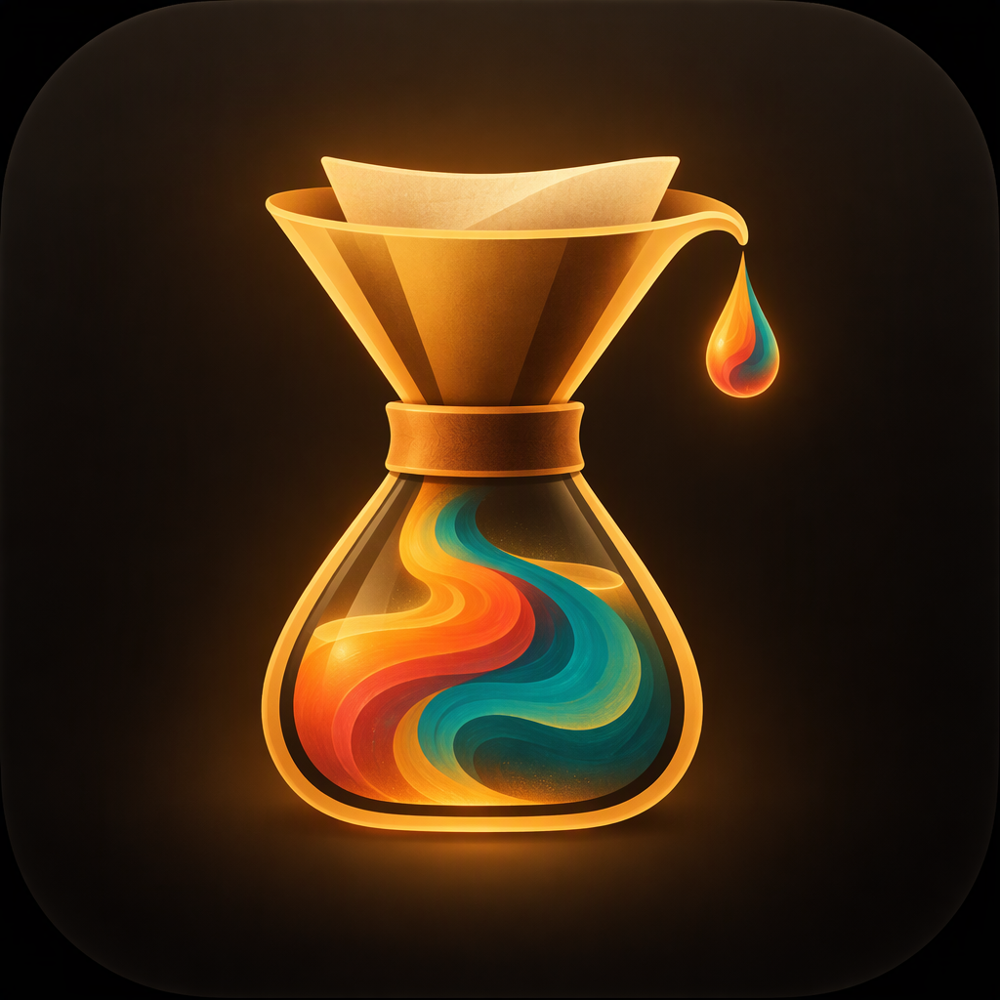
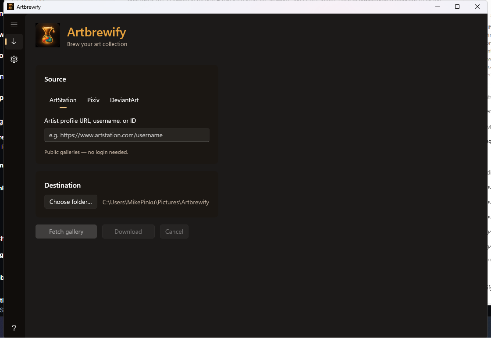

<p align="center">
  
</p>

<h1 align="center">Artbrewify</h1>

<p align="center"><strong>Brew your art collection.</strong></p>

<p align="center">
  Bulk-download an artist's entire gallery from ArtStation, Pixiv, and DeviantArt in original full resolution.<br />
  A modernized successor to <a href="https://github.com/sentouki/Artify">Artify</a>, rebuilt on .NET 8 and WinUI 3.
</p>

<p align="center">
  <a href="./LICENSE"></a>
  
  <a href="https://dotnet.microsoft.com/download/dotnet/8.0"></a>
  <a href="https://learn.microsoft.com/windows/apps/winui/winui3/"></a>
  <a href="https://github.com/pinkythegawd/Artbrewify/releases/latest"></a>
</p>

<details>
<summary>Table of contents</summary>

- [Screenshots](#screenshots)
- [Features](#features)
- [Install](#install)
  - [For users](#for-users)
  - [For developers](#for-developers)
- [Platform setup](#platform-setup)
- [Responsible use](#responsible-use)
- [Contributing](#contributing)
- [Credits](#credits)
- [License](#license)

</details>

## Screenshots

<p align="center">
  
</p>

## Features

**Downloads**
- Fetch an artist's entire gallery from ArtStation, Pixiv, or DeviantArt
- Original full-resolution files, not previews
- Concurrent downloads with retry and resume — already-downloaded files are skipped
- Pixiv ugoira (animations) saved as animated GIF

**App & security**
- Modern Fluent dark UI with live download progress
- Pixiv login via an embedded browser (WebView2)
- Tokens stored encrypted at rest with Windows DPAPI
- Bring-your-own DeviantArt API app credentials — no shared secrets baked into the binary

## Install

### For users

Download the latest build from the [Releases page](https://github.com/pinkythegawd/Artbrewify/releases/latest):

- **[Artbrewify-1.0.1-Setup.exe](https://github.com/pinkythegawd/Artbrewify/releases/download/v1.0.1/Artbrewify-1.0.1-Setup.exe)** — installer (recommended): per-user install, Start-menu shortcut, uninstaller.
- **[Artbrewify-1.0.1-portable-x64.exe](https://github.com/pinkythegawd/Artbrewify/releases/download/v1.0.1/Artbrewify-1.0.1-portable-x64.exe)** — portable single-file exe; no install needed.

Both are **self-contained** — no .NET or Windows App SDK install required. Windows 10 version 2004 (build 19041) or later, x64.

### For developers

**Prerequisites**
- Windows 10 version 2004 (build 19041) or later
- [.NET 8 SDK](https://dotnet.microsoft.com/download/dotnet/8.0)
- The Windows App SDK / WinUI 3 packages restore automatically via NuGet — no separate install is needed for command-line builds
- Optional: Visual Studio 2022 with the Windows App SDK / WinUI workload, for the XAML designer and debugging

**Build and run**

```powershell
dotnet build Artbrewify.sln
dotnet run --project src/Artbrewify
```

If your environment requires an explicit platform (the app targets x64), add `-p:Platform=x64`:

```powershell
dotnet build Artbrewify.sln -p:Platform=x64
dotnet run --project src/Artbrewify -p:Platform=x64
```

**Building the installer & portable exe**

Two self-contained distribution artifacts can be produced:

| Artifact | What it is | How to build |
|---|---|---|
| Portable exe | A single `Artbrewify.exe`; dependencies extract to a temp dir on first launch | `dotnet publish src/Artbrewify -c Release -p:PublishProfile=SingleFile` |
| Installer | `Artbrewify-1.0.1-Setup.exe` (Inno Setup) wrapping the self-contained folder | `dotnet publish src/Artbrewify -c Release -p:PublishProfile=Portable`, then compile `installer/Artbrewify.iss` |

Or run `build.cmd` to produce both in one step. Building the installer additionally requires [Inno Setup 6](https://jrsoftware.org/isinfo.php) (`winget install JRSoftware.InnoSetup`). Output lands in `artifacts/singlefile/` and `artifacts/installer/`.

## Platform setup

| Platform | What you need |
|---|---|
| ArtStation | Nothing — public galleries work out of the box |
| Pixiv | A Pixiv account (log in inside the app) |
| DeviantArt | Your own API app credentials from [deviantart.com/developers](https://www.deviantart.com/developers) (`client_credentials` grant), entered in Settings |

## Responsible use

Download artwork for personal archiving only. Respect artists' rights and each platform's terms of service. Aggressive bulk downloading can get your IP or account rate-limited or banned — keep concurrency settings sane.

## Contributing

Issues and pull requests are welcome. For large changes, please open an issue first to discuss the approach before investing time in a PR.

## Credits

- Original [Artify](https://github.com/sentouki/Artify) — Rodion Chaykovskiy (MIT)
- Pixiv OAuth flow research — [azuline/pixiv-api](https://github.com/azuline/pixiv-api) and the pixivpy community
- Platform API research — [mikf/gallery-dl](https://github.com/mikf/gallery-dl)
- Ugoira → GIF conversion — [Magick.NET / ImageMagick](https://github.com/dlemstra/Magick.NET)
- Built with [WinUI 3 / Windows App SDK](https://learn.microsoft.com/windows/apps/winui/winui3/)

## License

[MIT](./LICENSE). Preserves the original Artify copyright notice:

```text
Copyright (c) 2026 MikePinku (pinkythegawd)
Copyright (c) 2020 Rodion Chaykovskiy (original Artify project)
```